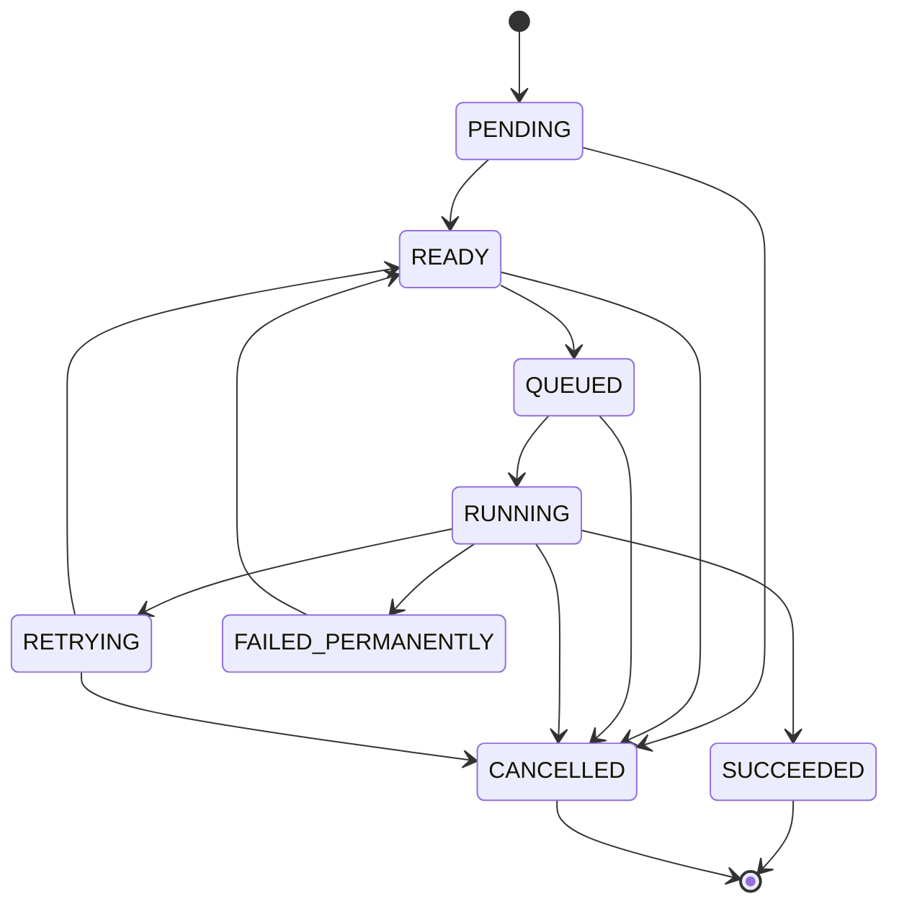
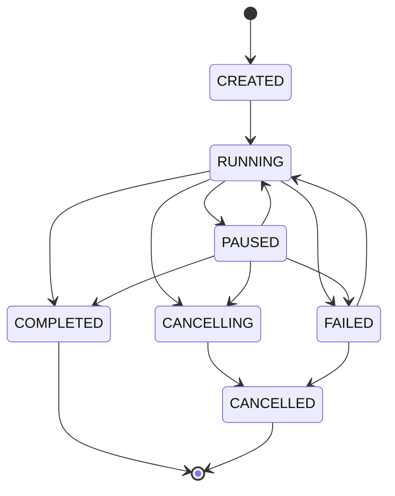

# State machines

> Generated from `TaskStateMachine` and `WorkflowStateMachine` by `StateMachinesDocument`. Do not edit by hand:
> the build fails (T03.5) if this file and the code disagree.

## Task execution

FAILED is not a task state: a failed attempt is recorded as an attempt outcome and the task moves straight to
RETRYING or FAILED_PERMANENTLY in the same transaction.

## Workflow execution

## Attempt outcomes

`SUCCEEDED`, `FAILED`, `TIMED_OUT`, `WORKER_LOST`, `WORKER_SHUTDOWN`, `CANCELLED`. `TIMED_OUT`, `WORKER_LOST`
and `WORKER_SHUTDOWN` are always retryable; `FAILED` is retryable if the executor says so.
